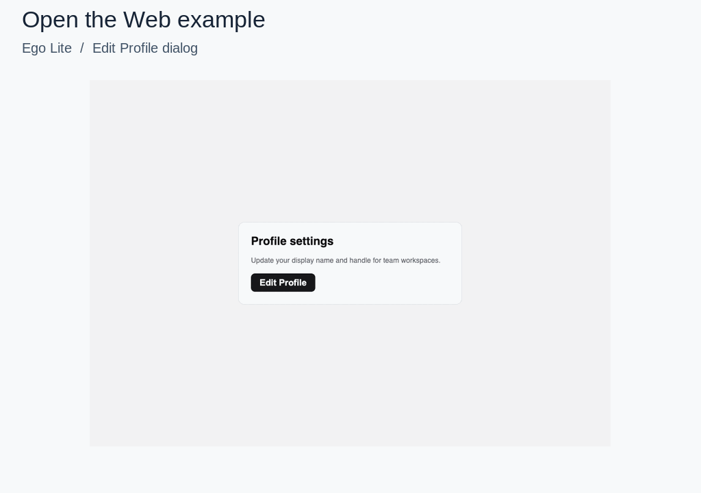
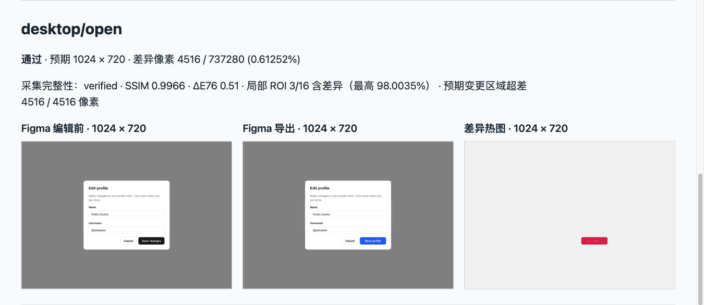

# Code Figma Mirror

[](LICENSE)
[](package.json)
[](native/README.md)

English | [简体中文](README.zh-CN.md)

Code Figma Mirror is a deterministic code-to-Figma and Figma-to-code mirror, sync, and UI parity engine for running frontend applications. You declare viewports, UI states, and the interactions between them; the live runtime supplies measured geometry, computed styles, component identities, and reference screenshots, while Figma receives editable variables, component instances, and prototype links whose rendered output can be audited and verified back against the source, with three-way diffing to sync design edits back into reviewable CSS patches.

## Why it exists

- **Runtime truth over static AST guessing**: Reads actual `BoundingBox`, computed styles, and font evidence from Playwright/Chromium (or WeChat DevTools) rather than guessing layout from static JSX/CSS.
- **Editable Figma reconstruction**: Generates Figma Variables, Component Sets, Instances, Auto Layout frames, and prototype transitions instead of flat screenshots or detached rectangles.
- **Closed-loop parity verification**: Audits structural geometry, text editability, component references, and click destinations (`audit`), and compares source vs. Figma PNGs pixel-by-pixel (`verify`).
- **Asymmetric 3-way reverse sync**: Compares `base`, `current` code, and `figma` snapshots to detect conflicts and emit reviewable CSS token/style patches (`review`, `review-styles`) without blindly overwriting business logic.

## Demo & Walkthrough (Public UI)

The [Edit Profile dialog](examples/public-ui/demo/index.html) is the fixed Web demo. This 48-second walkthrough uses real Ego Lite screenshots, Figma Desktop exports, a cropped plugin screenshot, the comparison report, and the generated patch.



1. Follow the installation steps below. Open the local example in your browser, click **Edit Profile**, then **Cancel**. Run `node examples/public-ui/demo/run-demo.mjs build/public-ui-demo` to capture both states. Later runs reuse the bundle.
2. In Figma Desktop, import **this checkout’s** `plugin/manifest.json` under **Plugins → Development → Import plugin from manifest…**. Run **UI Parity · 本地同步**, choose `bundle.json`, and import. When repeating a demo in an edited file, select **创建新的基线版本，保留现有设计** to create a fresh page. Export the untouched page and extract the ZIP directly into `build/public-ui-demo/original-figma/`.
3. On `desktop/open`, select the **Save changes** button instance and set its **Label** property to `Save profile`. In the new page’s variable collection change `primary` from `#18181B` to `#2563EB`. Export the same page again. Extract its `design-diff.json` and both 1× PNGs directly into `build/public-ui-demo/figma/`.
4. Rerun the command from step 1. Under `build/public-ui-demo/`, `baseline/report.html` compares Chromium with the untouched Figma export. `visual/report.html` compares the two Figma exports. `audit.json` checks layers, component properties, text and navigation. Exit code 2 requests a missing desktop export. Exit code 0 completes acceptance.
5. Open `review/tokens.patch` and `review/review.json` under the output directory. The demo uses the saved bundle for both base and current snapshots and checks the generated diff against the working CSS with `git apply --check`. The text edit stays in the design review. Applying a CSS change is a separate decision.

**Measured at 1024 × 720, 1×.** Chromium used pinned Arimo with grayscale smoothing. Figma exported without font warnings. Both stages matched 42 layers, 5 instances, 15 text-run line counts and both click destinations.

| Pixels exceeding 16/255 per channel | Closed | Open | Acceptance |
| --- | ---: | ---: | --- |
| Chromium vs. untouched Figma | 1,849 (0.251%) | 2,523 (0.342%) | Both below 1% |
| Figma before vs. after edits | 3,694 | 4,516 | 0 outside declared edit regions on either board |



The two intentional edits produced eight plugin change records, including changes propagated to bound fills and instance text. Review returned zero conflicts and one CSS declaration. The source kept `--primary: #18181b`.

To try the demo, follow the install steps below. When reporting a result in Issues, include the board name, the font substitutions from the export, and the reported pixel percentage.

## Installation & Quick start

Requires **Node.js >= 22**. From a clone of this repository:

```sh
npm ci
npx playwright install chromium
mkdir -p build/raster-acceptance/fonts
curl -fL 'https://raw.githubusercontent.com/google/fonts/903d46673260c1f4c7f7ef67f5190fb03eab5042/ofl/arimo/Arimo%5Bwght%5D.ttf' -o build/raster-acceptance/fonts/arimo.ttf

# Figma Desktop must have Arimo Regular and Bold available.
node examples/public-ui/demo/run-demo.mjs build/public-ui-demo

# Or run the Field notes benchmark capture
npm run demo
node cli.mjs inspect build/inbox/bundle.json
```

- **Figma Desktop plugin.** This run loaded `plugin/manifest.json` directly from the checkout. If you use a personal development plugin ID, keep the manifest, `code.js`, and `ui.html` from the same checkout together. Use the same registered plugin for import and both exports. [Plugin setup](plugin/README.md)
- **Figma MCP path (text, frames, solid variables, inline SVGs)**: See [mcp/README.md](mcp/README.md).

The **Field notes** example ([examples/inbox/scenarios.json](examples/inbox/scenarios.json)) captures an open list, a closed list, and three detail views on both phone (`375×700`) and desktop (`1024×720`). It produces 10 boards, 36 component occurrences, 16 replayed transitions, 6 color tokens, and 10 source PNGs in `build/inbox/source/`.

1. **Build the mirror in Figma.**
   - **Desktop plugin.** Open the registered plugin and load `build/inbox/bundle.json`. [Plugin setup](plugin/README.md)
   - **Figma MCP** ([mcp/README.md](mcp/README.md)): Use the transfer and render commands against your staging and output page IDs.
2. **Test the prototype.** Open the phone flow, switch lists, open a detail view, and navigate back. Inspect any card to verify it is linked to its main component.
3. **Audit and verify what Figma rendered.** Export the ZIP from the plugin (or collect node readbacks and 1× PNGs via [tools/cloud-export.md](tools/cloud-export.md)) into `build/figma/`, then run:

```sh
node cli.mjs audit build/inbox/bundle.json build/figma/design-diff.json build/audit.json
node cli.mjs verify build/inbox build/figma build/visual
```

`audit` checks geometry (default tolerance: `1` logical px), editable text, component references, and click destinations. `verify` generates `build/visual/report.html` with source, export, and diff heatmaps. Both exit with code `2` when mismatches are found.

## Architecture

| Path | Role |
| --- | --- |
| `cli.mjs`, `capture.mjs`, `capture-dom.mjs` | Playwright scenario runner, DOM/style/geometry/transition extractor |
| `audit.mjs`, `verify.mjs` | Structural readback audit and pixel-level PNG diff report |
| `review.mjs`, `style-review.mjs` | Three-way (`base` / `current` / `figma`) token and style patch generator |
| [`plugin/`](plugin/README.md) | Figma Desktop plugin for importing bundles, building components/flows, and exporting `design-diff.json` |
| [`mcp/`](mcp/README.md) | Figma MCP renderer, compact payload builder, and cross-page transfer helpers |
| [`native/`](native/README.md) | WeChat Mini-Program DevTools simulator adapter (`capture.mjs`, `measure.mjs`, `config.mjs`) |
| [`integrations/`](integrations/react.mjs) | Optional React JSX (`react.mjs`) and Vue SFC (`vue.mjs`) compile-time component identity probes |
| [`tools/`](tools/cloud-export.md) | Cloud export helpers and controlled raster acceptance (`raster-acceptance.mjs`) |
| [`skills/ui-parity/`](skills/ui-parity/SKILL.md) | Agent skill workflow for end-to-end capture, mirror, audit, and review |

## CLI reference

```sh
node cli.mjs capture <scenarios.json> <capture-dir> [--font-evidence] [--raster-profile <profile.json>]
node cli.mjs inspect <bundle.json>
node cli.mjs audit <bundle.json> <design-diff.json> <audit.json> [--geometry-tolerance 1]
node cli.mjs verify <capture-dir> <figma-png-dir> <report-dir> [--pixel-tolerance 16] [--max-diff-ratio 0.01]
node cli.mjs review <base.json> <current.json> <figma-snapshot.json> <out-dir> [--css theme.css] [--scenarios scenarios.json]
node cli.mjs review-styles <base.json> <current.json> <figma-snapshot.json> <out-dir> --css theme.css --mappings mappings.json
```

## Verified benchmark & boundaries

**Public UI cases.** We tested the shadcn/ui dialog, Plane mobile sign-in, and the Cal.com booking flow. All four declared prototype edges replayed in Chromium and matched their Figma destinations. All nine boards exceeded the 1% visual gate. The gallery includes full-resolution source images, Figma renders, heatmaps, and an offline replay. [Browse the public UI results](examples/public-ui/README.md)

The table compares the **same 10 Figma PNGs** against two Chromium captures of the example on macOS (`--pixel-tolerance 16 --max-diff-ratio 0.01`; see [examples/inbox/raster-capture.md](examples/inbox/raster-capture.md)):

| Browser reference | Desktop · 1024 × 720 | Phone · 375 × 700 |
| --- | ---: | ---: |
| Original page with system Arial | 5 of 5 | 1 of 5 |
| Pinned Arimo with grayscale font smoothing | 5 of 5 | 5 of 5 |

Figma readback verified **66 editable text layers**, **36 component instances**, and **16/16 prototype click destinations**. Against the unmodified DOM, pixel snapping and single-line text box widening shifted some positions/widths by up to `4.97 px`.

## Supported vs. Not Supported

| Capability | Status | Scope & Conditions |
| --- | --- | --- |
| Runtime Web & Mini-Program capture | Supported | Playwright/Chromium (`capture`) and WeChat DevTools simulator (`native/`) |
| Editable Figma reconstruction | Supported | Variables, Component Sets, Instances, Auto Layout, `ON_CLICK` (`NAVIGATE` / `OVERLAY` / `BACK`) |
| Structural & visual verification | Supported | `audit` checks geometry, instances, text, and edges. `verify` compares PNGs and reports pixel differences, `SSIM`, and `ΔE76`. |
| Controlled reverse CSS patches | Supported | 3-way `review` / `review-styles` emit reviewable `tokens.patch` / `styles.patch` for unambiguous CSS variables and mapped `width`, `height`, `border-radius`, `font-size` |
| Arbitrary bidirectional code ↔ Figma sync | **Not supported** | Reverse sync is strictly controlled and reviewable—patches are **never auto-applied** and structural tree edits require human/agent review |
| Lossless 1:1 arbitrary CSS conversion | **Not supported** | Complex CSS Grid, pseudo-elements, fluid `clamp()`, and custom shaders are approximated or flattened |
| Raster image imports via Figma MCP | **Not supported** | MCP renders text, frames, solid paints, and inline SVGs; captured raster assets require the Desktop Plugin |
| Unambiguous same-hex tokens in MCP | **Not supported** | MCP solid paint binding matches by color value; identical hex/RGBA tokens collapse |
| Guaranteed cross-OS pixel parity | **Not supported** | `--font-evidence` records font information. `--raster-profile` sets controlled capture conditions. Check the actual Figma font substitutions and exported pixels for each board. |

## Capture your own UI

Start from `examples/inbox/scenarios.json`. Point `states[].url` to a running app or local HTML file, provide a unique `ready` selector per state, and declare viewports and click `edges`:

```sh
node cli.mjs capture path/to/scenarios.json build/app --font-evidence
node cli.mjs inspect build/app/bundle.json
```

- **Component identity**: Annotate elements with `data-component` / `data-variant`, map by selector, or enable the [React](integrations/react.mjs) / [Vue](integrations/vue.mjs) compile-time plugins.
- **WeChat Mini-Programs**: See [native/README.md](native/README.md) for WeChat DevTools simulator capture and measurement.

## Review changes from Figma

Keep the imported `bundle.json` as `base.json`, re-capture current code to `current.json`, export the edited Figma revision as `design-diff.json`, and run:

```sh
node cli.mjs review base.json current.json build/figma/design-diff.json build/review \
  --scenarios examples/inbox/scenarios.json --css examples/inbox/theme.css
```

Inspect `build/review/review.json` for three-way conflicts and `tokens.patch` (or `styles.patch` via `review-styles`) for reviewable CSS updates.

## Development & Tests

```sh
npm test
npm run test:integrations
```

See [CONTRIBUTING.md](CONTRIBUTING.md) for setup, test expectations, and bug reporting, and [LICENSE](LICENSE) for the Apache-2.0 license.
