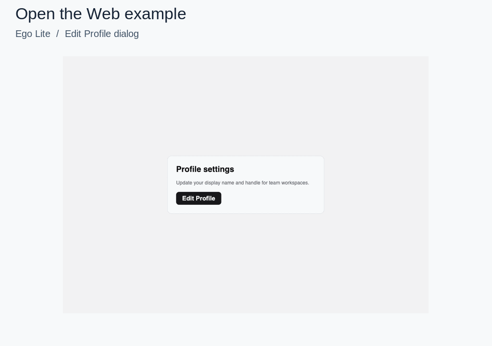
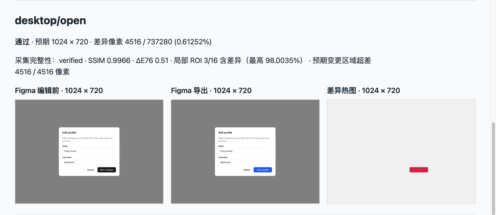

# Code Figma Mirror

[](LICENSE)
[](package.json)
[](native/README.md)

[English](README.md) | 简体中文

Code Figma Mirror 是一个面向运行态前端应用的**确定性代码 ↔ Figma 镜像、双向同步与 UI 一致性（Parity）校验引擎**。你只需要声明视口、页面状态与交互边；真实浏览器或小程序运行时提供实测几何尺寸、计算样式、组件身份和基准截图，Figma 端则重建为可编辑的 Variables、Component Instances 与交互原型，并通过结构审计、像素比对与三方差异（3-way diff）将设计修改安全地反向生成可审查的 CSS Patch。

## 核心设计理念

- **基于真实运行时采样，而非静态 AST 猜测**：直接从 Playwright/Chromium（或微信开发者工具）采集真实 `BoundingBox`、计算样式与字体渲染证据，避免静态源码解析导致的换行错位和高度塌陷。
- **可编辑的 Figma 组件级重建**：生成 Figma Variables、Component Sets、Instance、Auto Layout 与交互连线，而不是扁平截图或散落矩形。
- **闭环一致性验收**：`audit` 校验几何尺寸、文本可编辑性、组件引用与原型跳转目标；`verify` 对源截图与 Figma 导出图做逐像素比对并输出可视化热力图报告。
- **非对称三方反向同步**：联合对比 `base`、`current` 代码与 `figma` 快照，识别冲突并输出可审查的 CSS Token / 样式补丁（`review`、`review-styles`），不盲目覆盖业务逻辑。

## 演示流程与实测画面（Public UI）

固定演示使用 [Edit Profile 弹窗](examples/public-ui/demo/index.html)。这段 48 秒演示由 Ego Lite 实际截图、Figma Desktop 导出画板、插件窗口局部截图、差异报告和生成的补丁组成。



1. 按下方步骤安装，在浏览器打开本地示例，点 **Edit Profile** 打开弹窗，点 **Cancel** 返回。执行 `node examples/public-ui/demo/run-demo.mjs build/public-ui-demo` 采集这两个状态。再次运行会复用同一份 bundle。
2. 在 Figma Desktop 的 **Plugins → Development → Import plugin from manifest…** 选择**当前工作树**的 `plugin/manifest.json`。运行 **UI Parity · 本地同步**，导入 `bundle.json`。若同一文件已有编辑，勾选**创建新的基线版本，保留现有设计**。在编辑前导出 ZIP，直接解压到 `build/public-ui-demo/original-figma/`。
3. 在 `desktop/open` 选中 **Save changes** 按钮实例，在右侧将其 **Label** 属性改为 `Save profile`。在该版本的变量集合中，把 `primary` 从 `#18181B` 改为 `#2563EB`。再次导出同一页，把插件生成的 `design-diff.json` 与两张 1× PNG 直接解压到 `build/public-ui-demo/figma/`。
4. 再次执行第一步的命令。在 `build/public-ui-demo/` 中，`baseline/report.html` 对比 Chromium 与编辑前的 Figma，`visual/report.html` 对比 Figma 编辑前后。`audit.json` 检查图层、组件属性、文案和跳转。缺桌面导出时返回 2，完整验收通过时返回 0。
5. 在输出目录打开 `review/tokens.patch` 与 `review/review.json`。演示使用同一份采集包作为基线与当前代码快照，运行 `git apply --check` 检查生成的补丁。文案进入设计审核，是否应用 CSS 修改由审核者决定。

**本次实测条件为 1024 × 720、1× 导出。** Chromium 使用固定版本 Arimo 和灰度抗锯齿，Figma 导出无字体警告。两阶段均匹配 42 个图层、5 个实例、15 段文本的行数以及两条点击跳转。

编辑后的 `Save profile` 按钮文案单独做像素校验。参考图取自已验收的 Figma 导出，裁切为 94 × 16 像素，随示例提供。复验沿用每通道 16/255 的容差。[查看文案参考图](examples/public-ui/demo/save-profile.1x.png)

| 单通道超过 16/255 的像素 | 关闭画板 | 打开画板 | 验收结果 |
| --- | ---: | ---: | --- |
| Chromium 与编辑前 Figma | 1,849（0.251%） | 2,523（0.342%） | 均低于 1% |
| Figma 编辑前后 | 3,694 | 4,516 | 两张画板的预期区域外均为 0 |



两项主动编辑产生了 8 条插件差异记录，包含绑定填充和实例文字的联动变化。审核结果为 0 项冲突、1 处 CSS 声明修改。源码保留 `--primary: #18181b`。

欢迎按下方安装步骤复验。在 Issues 反馈时，请附上画板名、导出记录中的字体回退和报告里的超差像素占比。

## 安装入口与快速开始

需要 **Node.js >= 22**。克隆仓库后执行：

```sh
npm ci
npx playwright install chromium
mkdir -p build/raster-acceptance/fonts
curl -fL 'https://raw.githubusercontent.com/google/fonts/903d46673260c1f4c7f7ef67f5190fb03eab5042/ofl/arimo/Arimo%5Bwght%5D.ttf' -o build/raster-acceptance/fonts/arimo.ttf

# Figma Desktop 需要能加载 Arimo Regular 和 Bold。
node examples/public-ui/demo/run-demo.mjs build/public-ui-demo

# 或运行 Field notes 基准采集
npm run demo
node cli.mjs inspect build/inbox/bundle.json
```

- **Figma Desktop 插件入口。** 本次直接加载当前仓库的 `plugin/manifest.json`。使用个人开发插件 ID 时，请将同一工作树的 manifest、`code.js` 和 `ui.html` 放在同一目录。导入和两次导出均使用同一个已登记的插件。[插件安装说明](plugin/README.md)
- **Figma MCP 入口（文本、Frame、纯色变量与内联 SVG）**：详见 [mcp/README.md](mcp/README.md)。

**Field notes** 示例（[examples/inbox/scenarios.json](examples/inbox/scenarios.json)）会在手机端（`375×700`）与桌面端（`1024×720`）采集打开列表、关闭列表和三个详情态，生成包含 10 个画板、36 个组件实例、16 条已验证交互跳转、6 个颜色 Token 的 `bundle.json`，并在 `build/inbox/source/` 下输出 10 张基准 PNG。

1. **在 Figma 中重建镜像**
   - **桌面插件。** 打开已登记的插件，加载 `build/inbox/bundle.json`。[插件说明](plugin/README.md)
   - **Figma MCP 路径**（[mcp/README.md](mcp/README.md)）：使用 `mcp/` 提供的传输与渲染命令写入你的暂存页和目标页。
2. **验证交互原型**：在手机端流程中切换列表、进入详情页并返回；选中卡片检查其主组件引用。
3. **结构审计与像素验收**：从插件导出 ZIP（或通过 [tools/cloud-export.md](tools/cloud-export.md) 收集节点回读与 1× PNG）解压到 `build/figma/`，运行：

```sh
node cli.mjs audit build/inbox/bundle.json build/figma/design-diff.json build/audit.json
node cli.mjs verify build/inbox build/figma build/visual
```

`audit` 默认允许 `1` 逻辑像素的几何容差；`verify` 会生成包含原图、Figma 导出图与差异热力图的 `build/visual/report.html`。两者在发现差异时均返回退出码 `2`。

## 仓库架构

| 目录 / 文件 | 职责 |
| --- | --- |
| `cli.mjs`, `capture.mjs`, `capture-dom.mjs` | Playwright 场景执行器，DOM/样式/几何/跳转采集 |
| `audit.mjs`, `verify.mjs` | 结构回读审计与逐像素 PNG 差异报告 |
| `review.mjs`, `style-review.mjs` | 三方（`base` / `current` / `figma`）Token 与样式补丁生成 |
| [`plugin/`](plugin/README.md) | Figma Desktop 插件：导入 bundle、生成组件/原型、导出 `design-diff.json` |
| [`mcp/`](mcp/README.md) | Figma MCP 渲染器、紧凑载荷构建与跨页传输工具 |
| [`native/`](native/README.md) | 微信小程序开发者工具模拟器适配（`capture.mjs`, `measure.mjs`, `config.mjs`） |
| [`integrations/`](integrations/react.mjs) | 可选的 React JSX（`react.mjs`）与 Vue SFC（`vue.mjs`）编译期组件身份探针 |
| [`tools/`](tools/cloud-export.md) | 云端导出辅助与可控光栅验收（`raster-acceptance.mjs`） |
| [`skills/ui-parity/`](skills/ui-parity/SKILL.md) | 面向 Agent 的端到端采集、镜像、审计与反向同步工作流 |

## CLI 命令参考

```sh
node cli.mjs capture <scenarios.json> <capture-dir> [--font-evidence] [--raster-profile <profile.json>]
node cli.mjs inspect <bundle.json>
node cli.mjs audit <bundle.json> <design-diff.json> <audit.json> [--geometry-tolerance 1] [--expected-changes <changes.json>]
node cli.mjs verify <capture-dir> <figma-png-dir> <report-dir> [--pixel-tolerance 16] [--max-diff-ratio 0.01] [--expected-changes <changes.json>]
node cli.mjs review <base.json> <current.json> <figma-snapshot.json> <out-dir> [--css theme.css] [--scenarios scenarios.json]
node cli.mjs review-styles <base.json> <current.json> <figma-snapshot.json> <out-dir> --css theme.css --mappings mappings.json
```

## 已验证基准与当前边界

**公开前端实测。** shadcn/ui 弹窗、Plane 手机登录页、Cal.com 预约流程共测了 9 张画板，其中 7 张来自在线页面，2 张来自冻结的组件样例。4 条点击路径都在 Chromium 中回放成功，Figma 回读的目标画板也一致。9 张画板的超差像素占比均超过 1%。案例附有原图、Figma 渲染、差异热图和离线复验命令。[查看逐板结果](examples/public-ui/README.md)

下表在 macOS 上用**同一组 10 张 Figma 导出 PNG** 对比两组 Chromium 基准截图（`--pixel-tolerance 16 --max-diff-ratio 0.01`，详见 [examples/inbox/raster-capture.md](examples/inbox/raster-capture.md)）：

| 浏览器基准 | 桌面端 · 1024 × 720 | 手机端 · 375 × 700 |
| --- | ---: | ---: |
| 原始页面（系统 Arial） | 5 / 5 | 1 / 5 |
| 锁定 Arimo 字体与灰度抗锯齿 | 5 / 5 | 5 / 5 |

Figma 回读验证了 **66 个可编辑文本图层**、**36 个组件实例**与 **16/16 条原型点击跳转**。相对未修改的 DOM，像素对齐与单行文本框加宽使部分位置/宽度产生最多 `4.97 px` 偏移。

## 支持与不支持清单

| 能力 | 状态 | 适用范围与条件 |
| --- | --- | --- |
| 运行态 Web 与小程序采集 | 支持 | Playwright/Chromium（`capture`）与微信开发者工具模拟器（`native/`） |
| 可编辑 Figma 重建 | 支持 | Variables、Component Sets、Instance、Auto Layout、`ON_CLICK`（`NAVIGATE` / `OVERLAY` / `BACK`） |
| 结构与像素一致性验收 | 支持 | `audit` 检查几何、实例、文本与跳转。`verify` 对比 PNG 并报告逐像素差异、`SSIM` 和 `ΔE76`。 |
| 受控反向 CSS 补丁 | 支持 | 三方对比 `review` / `review-styles` 仅针对无歧义 CSS 变量及显式映射的 `width`、`height`、`border-radius`、`font-size` 生成可审核 `tokens.patch` / `styles.patch` |
| 任意代码 ↔ Figma 双向同步 | **不支持** | 反向补丁为受控、可审核输出，**不会自动写入代码**；组件树结构改动需人工或 Agent 审查 |
| 任意复杂 CSS 1:1 无损转换 | **不支持** | 复杂 CSS Grid、伪元素、流体 `clamp()`、自定义着色器会近似或扁平化 |
| 通过 Figma MCP 导入位图资源 | **不支持** | MCP 路径仅支持文本、Frame、纯色填充与内联 SVG；位图资源需走桌面插件路径 |
| MCP 下同色值不同语义 Token 区分 | **不支持** | MCP 渲染器按色值反查绑定纯色 Variable，同 Hex/RGBA Token 会合并 |
| 保证跨系统像素完全一致 | **不支持** | `--font-evidence` 记录字体信息，`--raster-profile` 设置受控采集条件。每张画板仍需核对 Figma 实际使用的字体和导出像素。 |

## 采集你自己的界面

可从 `examples/inbox/scenarios.json` 起步，将 `states[].url` 指向运行中的应用或本地 HTML，为每个状态配置唯一 `ready` 选择器，并声明视口与点击 `edges`：

```sh
node cli.mjs capture path/to/scenarios.json build/app --font-evidence
node cli.mjs inspect build/app/bundle.json
```

- **组件身份标记**：在宿主元素上添加 `data-component` / `data-variant`，通过选择器映射，或启用 [React](integrations/react.mjs) / [Vue](integrations/vue.mjs) 编译期插件。
- **微信小程序**：参考 [native/README.md](native/README.md) 使用微信开发者工具模拟器采集与测量。

## 反向审查 Figma 修改

保留导入时的 `bundle.json` 作为 `base.json`，代码变更后重新采集到 `current.json`，从 Figma 导出修订后的 `design-diff.json`，然后运行：

```sh
node cli.mjs review base.json current.json build/figma/design-diff.json build/review \
  --scenarios examples/inbox/scenarios.json --css examples/inbox/theme.css
```

查看 `build/review/review.json` 中的三方冲突，以及 `tokens.patch`（或通过 `review-styles` 生成的 `styles.patch`）进行代码审查后合入。

## 开发与测试

```sh
npm test
npm run test:integrations
```

环境搭建、测试规范与问题反馈请见 [CONTRIBUTING.md](CONTRIBUTING.md)，开源协议见 [LICENSE](LICENSE)（Apache-2.0）。
